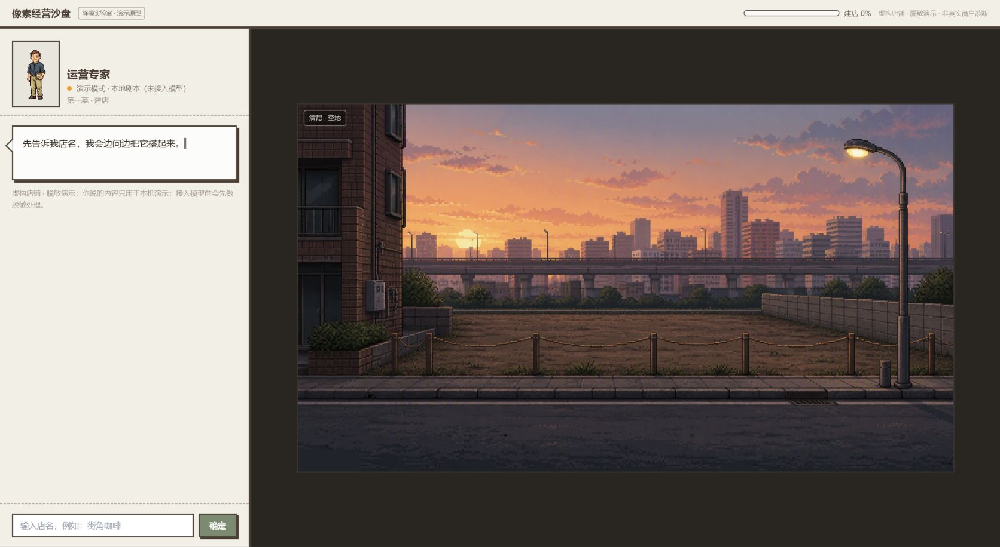
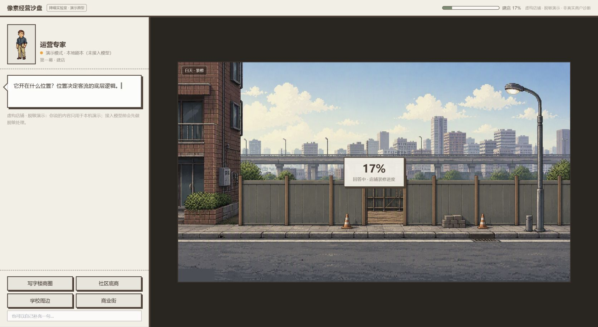
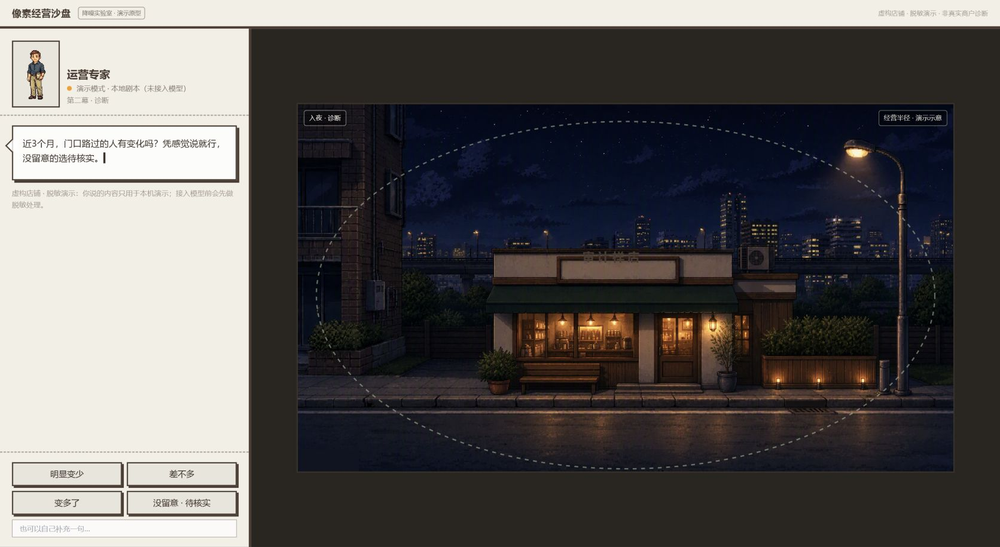
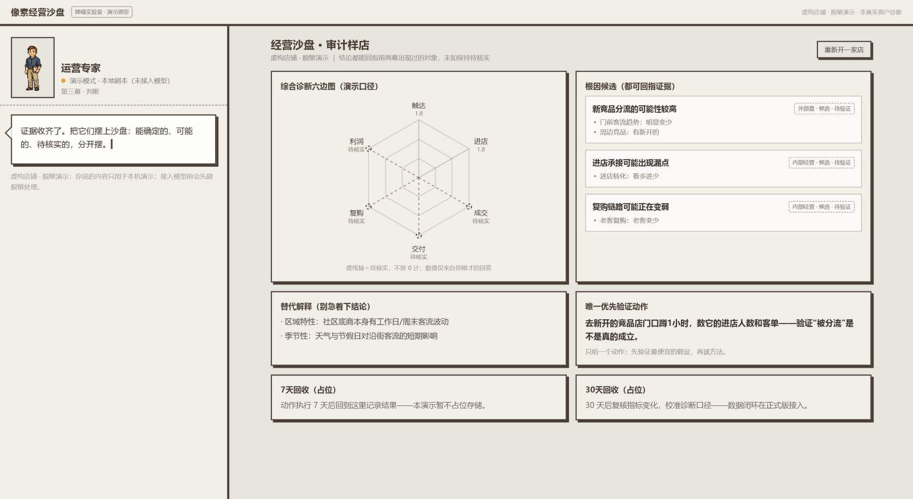

# ThinkPair 像素经营沙盘｜Codex／Kimi 来源混用审计

> [!note] 当前执行口径已更新
> 本页保留混用事故的现场审计。其“保留Kimi候选、Codex沿用旧四帧、双方共享只读合同”的调整方案已被用户最新决定替代：两边都从零重跑；Codex在台式机同步vault内单写，Kimi在笔记本vault外独立运行，双方不共享中间产物。见[[20_理解/ThinkPair双AI网页混用事故复盘与执行隔离-2026-08-05]]。

## 审计结论

当前 7100 不是一个可继续迭代的单一版本，而是：

- Kimi 初始化的 React／Vite／Tailwind 工程、左右分栏 DOM、旧 NPC、旧结果看板；
- Kimi Work 生成的四张 `scene-dawn/day/dusk/night` 分层场景；
- Codex 生成但当时未被当前 JSX 引用的批准样张、新运营专家 NPC；
- Codex 写入但后续 JSX 不再引用的全屏场景 CSS；
- 双方先后修改后的诊断脚本、DeepSeek 代理和派生构建物。

2026-08-05 16:34 的 `web/design-qa.md` 与 16:37 的“B 版实现验收通过”记录，已被 16:38—16:41 发生的核心源码覆盖推翻。Kimi 随后把其版本迁到 vault 外的独立目录 `C:\Users\62574\Desktop\像素经营沙盘` 并清空 vault 内共享 `web`；Kimi 独立目录保留左右分栏版本并已完成自身构建与冒烟，Codex 独立 B 版尚未重建。用户对四张视觉样张的“整体通过”仍然有效，但两版必须分别验收。

## 当前流程截图

### 1. 开始建店｜高风险

- 当前是 420px 左侧工具面板＋右侧场景，不是批准样张中的全屏固定镜头。
- 页面继续显示“演示原型”“虚构店铺”“未接入模型”等第三方说明式文案。
- 当前 NPC 使用旧角色，不是已批准的眼镜、胡茬、棕色外套角色。

### 2. 装修进行中｜高风险

- 时间底板能够切换，建店进度能够更新，这是可保留的技术能力。
- 但装修只表现为围挡＋中心百分比，缺少批准帧中的逐层结构、工人和在场感。
- 最后一个建店答案会直接切到第二幕，黄昏“建店完成→开始诊断”状态不可停留。

### 3. 进入诊断｜高风险

- 夜间场景能够出现，但 NPC、气泡和答案仍在独立左栏，经营现场没有成为交互主体。
- 竞品、客流、复购和利润尚未以实体街区对象逐层显影。
- “经营半径·演示示意”再次把产品退回讲解页面。

### 4. 综合判断｜高风险

- 第三幕直接换成米白后台卡片页，固定街景镜头被切断。
- 雷达显示 `1.8` 等由定性选项映射的小数，形成不必要的虚假精度。
- “7天回收（占位）”“30天回收（占位）”和多块说明卡，让结果页重新变成文字型工具。

## 来源矩阵

| 范围 | 来源 | 审计时状态 | 证据 |
|---|---|---|---|
| React／Vite／Tailwind、`components/ui/*` | Kimi 初始化 | 当时是基础设施 | `template-info.md` 曾保留 `/mnt/agents/output/app`；工程曾含 `kimi-plugin-inspect-react` |
| 左右分栏、旧 NPC、旧结果页 | Kimi | 当时是实际 DOM | 审计截图与 16:38—16:41 的核心源码快照 |
| M1／M2 素材与 `scene-dawn/day/dusk/night` | Kimi Work | 证明集仍保留 | `资产证明集` 与当时 `public/assets` 中副本一致 |
| 四张已批准视觉样张、`scene-sunset.png` | Codex 内置 ImageGen | 样张仍是视觉权威 | `artifacts/visual-samples-v0.3-2026-08-05/README.md` |
| `npc-operator-v1*` | Codex ImageGen＋本地去底 | 审计时未被引用，后随 `web` 清空 | 当前截图仍显示 Kimi 旧 NPC |
| 全屏场景 CSS | Codex | 审计时是未接线残留，后随 vault 内 `web` 清空 | `.scene-shell/.npc-sprite/.npc-bubble/.result-panel` 当时在 TSX 中无引用 |
| `dist/` | 混合树派生物 | 已随 `web` 清空，不可作验收证据 | 构建时间晚于四个核心源码的后续覆盖时间 |

## 根因

1. Codex 与 Kimi 没有各自独立的代码根、端口和 Git 基线。
2. Codex 在 Kimi 工程目录内继续实现批准样张，Kimi 同时仍有写权限。
3. 双方都修改 `App.tsx`、`SceneCanvas.tsx`、`NpcPanel.tsx`、`SandboxResult.tsx`，最后写入者覆盖前一版。
4. 验收记录写在 16:34—16:37，但核心源码在 16:38—16:41 被再次覆盖；验收没有绑定 commit 或哈希。
5. 当时同时存在 `::1:7100` 的 Kimi runtime 与 `127.0.0.1:7100/7101/7102` 的多个 Node/Vite 实例；同一个“localhost:7100”并不稳定指向同一实现。
6. 素材没有 `codex/`、`kimi/`、`reference/` 命名空间，导致批准样张、分层底板和旧资产进入同一依赖池。

## 调整方案

### 双版本设计合同

- Codex 版以用户已经批准的四张 16:9 样张为自己的视觉权威，保持全屏固定镜头、场景内 NPC 和右下诊断面板。
- Kimi 版保留 Kimi 自己的视觉、资产和交互判断，不再引用 Codex 样张、NPC、CSS 或组件；Codex 同样不引用 Kimi 可写工程。
- 两版只共享一份只读产品逻辑合同：三幕流程、第一条“客户为什么越来越少”诊断链、整店六维口径、证据不足显示待核实、只给一个优先动作。
- 两版都必须显式经过 `DAWN_EMPTY → DAY_BUILDING → DUSK_READY → NIGHT_DIAGNOSE → NIGHT_JUDGMENT`；视觉表现可以独立。
- 没有真实量化证据时不显示 1.8、2.5 等小数分；这是共同真实性边界，不是某一版的美术规则。

### 物理隔离

- Kimi 已迁至 vault 外独立目录；Codex 另建独立目录。两边必须继续使用独立 Git 仓库、依赖、环境变量、素材、QA 和 release。
- Codex 固定端口 3000；Kimi 可保留其严格锁定的 7100，但 Codex 不再启动 7100—7102。审计后已停止三个孤立的 Codex Vite 进程，只保留 Kimi runtime。
- 资产分别进入 `public/assets/codex/`、`public/assets/kimi/`、`references/approved-v0.3/`；禁止跨目录 `../` 引用和共享可写素材。
- 公共对比目录只接收截图、构建包和 manifest 副本，不接收源码或符号链接。
- 每次验收必须绑定 commit SHA、关键文件 SHA256、端口、截图和测试记录；没有这些证据不得写 PASS。

## 无障碍与证据限制

- 审计截图中大量 10—12px 浅灰文字有可读性风险；按钮焦点、键盘顺序、读屏标签和动态状态播报未完成专项测试。
- 本轮在 1672×941 捕获了开始、建店、诊断和判断四个状态，并与批准帧同输入对照；没有验证真实 DeepSeek 在线返回。
- 本轮没有继续修改 Kimi 独立工程或混合树正式代码；仅停止了三个指向旧共享目录的孤立 Codex Vite 进程，并纠正验收事实。
